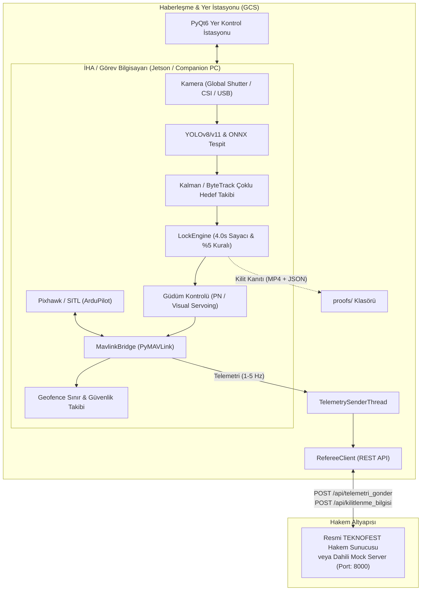

# AeroCombat - TEKNOFEST Savaşan İHA Otonom İt Dalaşı ve Görev Kontrol Sistemi 🦅🎯

[](https://www.python.org/)
[](https://teknofest.org/)
[](https://github.com/ultralytics/ultralytics)
[](https://ardupilot.org/)
[](https://fastapi.tiangolo.com/)
[](LICENSE)

**AeroCombat**, TEKNOFEST Savaşan İHA (Fighter UAV) yarışmasına katılacak takımlar için geliştirilmiş; **Görüntü İşleme, Otonom Kilitlenme, Hakem Sunucusu Haberleşmesi, Uçuş Güdümü ve Yer Kontrol İstasyonu (YKİ)** bileşenlerini içeren endüstriyel standartlarda, açık kaynaklı ve modüler bir hazırlık çerçevesidir.

Sistem, fiziksel bir İHA'ya veya yarışma alanına ihtiyaç duymadan **Sentetik Kamera ve Dahili Mock Hakem Sunucusu** ile sıfırdan simüle edilebilir; sahaya çıkıldığında ise doğrudan **Jetson Orin/Xavier ve Pixhawk** donanımlarına bağlanarak gerçek uçuşta kullanılabilir.

---

## 📑 İçindekiler
- [Sistem Mimarisi](#-sistem-mimarisi)
- [Öne Çıkan Yetenekler](#-öne-çıkan-yetenekler)
- [Dizin Yapısı](#-dizin-yapısı)
- [Kurulum Adımları](#-kurulum-adımları)
- [Hızlı Başlangıç (Simülasyon Modu)](#-hızlı-başlangıç-simülasyon-modu)
- [Hakem Sunucusu ve Mock Server](#-hakem-sunucusu-ve-mock-server)
- [Kilitlenme Mantığı ve Şartname Kriterleri](#-kilitlenme-mantığı-ve-şartname-kriterleri)
- [Birim Testleri (pytest)](#-birim-testleri-pytest)
- [Dokümantasyon Bağlantıları](#-dokümantasyon-bağlantıları)

---

## 🏛 Sistem Mimarisi



---

## ✨ Öne Çıkan Yetenekler

1. **Şartnameye %100 Uyumlu Otonom Kilitlenme Motoru (`LockEngine`):**
   * **4.0 Saniye Kesintisiz Süre:** Hedef kadrajın merkezinde tutulurken milisaniye hassasiyetli kesintisiz sayaç.
   * **%5 Alan Oranı Kuralı:** Hedef İHA'nın ekran alanına oranı en az %5 (`hedef_alan_orani_min`) olmadan sayaç başlamaz.
   * **Tolerans Süresi (`hold_grace_time`):** Ani rüzgar veya sarsıntılarda hedefin 0.35 saniyeye kadar anlık kayıplarında sayacın gereksiz sıfırlanmasını önler.
   * **Otomatik Kanıt Üretimi:** Kilitlenme sağlandığı an, kilit öncesi ve anına ait **MP4 video kaydı** ile kilitlenme başlangıç-bitiş zaman damgalarını içeren **JSON metadata** dosyasını otomatik oluşturur.

2. **Dahili Mock Hakem Sunucusu (`mock_server/`):**
   * Resmi yarışma sunucusunun 1:1 klonudur (`/api/giris`, `/api/sunucusaati`, `/api/telemetri_gonder`, `/api/kilitlenme_bilgisi`, `/api/cikis`).
   * Canlı web izleme arayüzü sunar (`http://127.0.0.1:8000`), takımların telemetrisini ve skorlarını anlık gösterir.
   * Sahada yarışma çadırına girmeden önce tüm telemetri akışını ve kilit paketlerini hatasız test etmenizi sağlar.

3. **Askeri Standartta Head-Up Display (HUD) & PyQt6 GCS:**
   * Yapay ufuk çizgisi (roll/pitch).
   * Kilitlenme geri sayım halkası ve dinamik renk kodlaması (Cyan $\rightarrow$ Sarı $\rightarrow$ Yeşil Kilit).
   * Rakip radar listesi, telemetri göstergeleri, tek tıkla Acil RTL ve Mod değiştirme butonları.

4. **Sınır ve Güvenlik Monitörü (`Geofence`):**
   * Ray-casting algoritması ile yarışma poligon sınırlarını sürekli denetler.
   * Sanal sınıra yaklaşınca sarı alarm üretir; sınır dışına çıkıldığında diskalifiye olmamak için otomatik RTL (Eve Dönüş) sinyali üretir.

5. **Gelişmiş Güdüm Algoritmaları (`Guidance`):**
   * **Proportional Navigation (PN):** Hava-hava füze ve önleme güdüm kanunu ile rakip İHA rotasını kesme.
   * **Visual Servoing PD:** Kamera piksel hatasına göre uçağı hedefe doğru otonom yönlendirme.

---

## 📂 Dizin Yapısı

```text
teknofest_savasan_iha/
├── config/
│   ├── default_config.yaml       # Sistem genel ayarları (kamera, sunucu, kilit, otopilot)
│   └── competition_rules.yaml    # TEKNOFEST şartname parametreleri ve ceza katsayıları
├── core/
│   ├── models.py                 # TelemetriPaketi, KilitlenmePaketi, ZamanBilgisi modelleri
│   ├── logger.py                 # Renkli konsol ve döngüsel dosya loglayıcı
│   └── event_bus.py              # Thread-safe pub/sub asenkron olay yöneticisi
├── vision/
│   ├── detector.py               # YOLOv8/v11, ONNX ve Sanal Hedef Dedektörü
│   ├── tracker.py                # Kalman Filtresi ve IoU tabanlı çoklu hedef takipçisi
│   ├── lock_engine.py            # 4.0 sn kesintisiz kilitlenme ve kanıt kayıt motoru
│   └── visualizer.py             # Askeri HUD ve hedef kutusu çizici katmanı
├── referee/
│   ├── client.py                 # Hakem sunucusu REST API istemcisi
│   ├── time_sync.py              # RTT gecikme hesaplamalı sunucu saati senkronizasyonu
│   └── telemetry_sender.py       # 1-5 Hz periyodik telemetri gönderim iş parçacığı
├── mock_server/
│   └── app.py                    # FastAPI tabanlı yerel test hakem sunucusu ve web paneli
├── autopilot/
│   ├── mavlink_bridge.py         # PyMAVLink bağlantısı (Pixhawk / SITL)
│   ├── guidance.py               # PN (Proportional Navigation) ve Visual Servoing
│   └── geofence.py               # 2D Poligon sınır ihlali ve irtifa denetimi
├── gcs/
│   └── app.py                    # PyQt6 Yer Kontrol İstasyonu arayüzü
├── simulation/
│   └── virtual_camera.py         # Sentetik gökyüzü ve hareketli rakip İHA video akışı
├── tools/
│   ├── dataset_collector.py      # Uçuş videolarından eğitim karesi çıkarma
│   └── export_onnx.py            # YOLO modellerini TensorRT/ONNX formatına derleme
├── tests/
│   ├── test_models.py            # JSON paket doğrulama testleri
│   ├── test_lock_engine.py       # 4 sn ve %5 kuralı birim testleri
│   └── test_geofence.py          # Geofence poligon testleri
├── docs/                         # Kapsamlı teknik rehberler
│   ├── YARISMA_REHBERI.md
│   ├── DONANIM_LISTESI.md
│   ├── HABERLESME_PROTOKOLU.md
│   └── MAVLINK_REHBERI.md
├── main.py                       # Ana sistem başlatıcı
├── requirements.txt              # Bağımlılıklar
└── README.md
```

---

## 🚀 Kurulum Adımları

1. Repoyu klonlayın ve dizine girin:
```bash
git clone https://github.com/kullaniciadi/teknofest_savasan_iha.git
cd teknofest_savasan_iha
```

2. Python sanal ortamı oluşturun ve aktif edin:
```bash
python -m venv venv
# Windows için:
.\venv\Scripts\activate
# Linux/macOS için:
source venv/bin/activate
```

3. Bağımlılıkları yükleyin:
```bash
pip install -r requirements.txt
```

---

## 🎮 Hızlı Başlangıç (Simülasyon Modu)

Herhangi bir donanım veya kamera bağlamadan tüm sistemi (Görüntü İşleme + Otonom Kilitlenme + Telemetri + Dahili Mock Sunucu + YKİ Arayüzü) tek komutla başlatabilirsiniz:

```bash
python main.py
```

* Sistem arka planda **Mock Hakem Sunucusu**'nu (`http://127.0.0.1:8000`) ayağa kaldırır.
* Sanal kamera akışında rakip İHA manevralar yapar.
* Hedef merkeze girdiğinde 4 saniyelik kilitlenme sayacı başlar.
* 4 saniye dolduğunda kilitlenme otomatik onaylanır, kanıt videosu `proofs/` klasörüne kaydedilir ve hakem paneline **+100 puan** olarak yansır!

### Ek Parametreler:
* **Arayüzsüz (Hafif OpenCV Penceresi):**
  ```bash
  python main.py --no-gui
  ```
* **Harici/Resmi Hakem Sunucusuna Bağlanırken (Mock Sunucu Kapalı):**
  ```bash
  python main.py --no-mock-server --config config/default_config.yaml
  ```

---

## 📡 Hakem Sunucusu ve Mock Server

Ayrı bir terminalde bağımsız Mock Hakem Sunucusunu çalıştırmak için:
```bash
python -m mock_server.app
```
Tarayıcınızdan `http://127.0.0.1:8000` adresini açarak canlı **Hakem İzleme Paneli**'ni görüntüleyebilirsiniz.

---

## 🧪 Birim Testleri (pytest)

Tüm matematiksel modelleri, şartname kilitlenme kurallarını ve geofence algoritmalarını doğrulamak için testleri çalıştırın:

```bash
pytest tests/ -v
```

---

## 📚 Dokümantasyon Bağlantıları
* 📖 [Yarışma Taktikleri & Strateji Kılavuzu](docs/YARISMA_REHBERI.md)
* 🛠 [Önerilen Donanım ve Sensör Listesi](docs/DONANIM_LISTESI.md)
* 🌐 [Hakem Sunucusu Haberleşme Protokolü & JSON Şemaları](docs/HABERLESME_PROTOKOLU.md)
* ✈️ [MAVLink & Pixhawk / ArduPilot SITL Rehberi](docs/MAVLINK_REHBERI.md)

---

## 📜 Lisans
Bu proje [MIT Lisansı](LICENSE) ile lisanslanmıştır. TEKNOFEST Savaşan İHA takımlarının kullanımına ve geliştirmesine tamamen açıktır. Başarılar dileriz! 🚀
