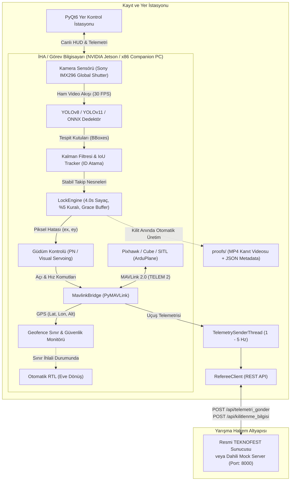

# 🦅 AeroCombat - TEKNOFEST Savaşan İHA Otonom İt Dalaşı ve Görev Kontrol Sistemi

<div align="center">

[](https://www.python.org/)
[](https://teknofest.org/)
[](https://github.com/ultralytics/ultralytics)
[-1E88E5)](https://ardupilot.org/)
[](https://fastapi.tiangolo.com/)
[](https://riverbankcomputing.com/software/pyqt/)
[](tests/)
[](Dockerfile)
[](.github/workflows/ci.yml)
[](LICENSE)

**TEKNOFEST Savaşan İHA (Fighter UAV) Yarışması İçin Geliştirilmiş Uçtan Uca Otonom Hava Muharebesi, Görüntü İşleme, Hedef Kilitlenme, Güdüm ve Yer Kontrol İstasyonu Çerçevesi**

</div>

---

## 📑 İçindekiler
1. [Projenin Amacı ve Vizyonu](#-projenin-amacı-ve-vizyonu)
2. [Sistem Mimarisi](#-sistem-mimarisi)
3. [Şartnameye %100 Uyumlu Kilitlenme Motoru](#-şartnameye-100-uyumlu-kilitlenme-motoru)
4. [Hava-Hava Güdüm Kanunları ve Uçuş Dinamiği](#-hava-hava-güdüm-kanunları-ve-uçuş-dinamiği)
5. [Hakem Sunucusu Entegrasyonu ve Saat Senkronizasyonu](#-hakem-sunucusu-entegrasyonu-ve-saat-senkronizasyonu)
6. [Dahili Mock Hakem Sunucusu](#-dahili-mock-hakem-sunucusu)
7. [Geofence ve Sınır Güvenliği](#-geofence-ve-sınır-güvenliği)
8. [Askeri Standartta Head-Up Display (HUD) ve GCS](#-askeri-standartta-head-up-display-hud-ve-gcs)
9. [Donanım Mimarisi ve Kablolama](#-donanım-mimarisi-ve-kablolama)
10. [Dizin Yapısı](#-dizin-yapısı)
11. [Kurulum ve Hızlı Başlangıç](#-kurulum-ve-hızlı-başlangıç)
12. [Uçuş Öncesi Kontrol (Pre-Flight Check)](#-uçuş-öncesi-kontrol-pre-flight-check)
13. [Uçuş Telemetri Oynatıcısı (Log Player)](#-uçuş-telemetri-oynatıcısı-log-player)
14. [Model Eğitimi ve ONNX / TensorRT Derleme](#-model-eğitimi-ve-onnx--tensorrt-derleme)
15. [Birim Testleri](#-birim-testleri)
16. [Saha İpuçları ve Sık Karşılaşılan Sorunlar (SSS)](#-saha-ipuçları-ve-sık-karşılaşılan-sorunlar-sss)
17. [Lisans](#-lisans)

---

## 🎯 Projenin Amacı ve Vizyonu

TEKNOFEST Savaşan İHA yarışması; sabit kanat veya döner kanatlı insansız hava araçlarının, tahsis edilmiş bir hava sahasında tamamen otonom ya da yarı otonom olarak birbirlerini tespit etmesini, takip etmesini ve hava-hava it dalaşı (dogfight) manevralarıyla **kilitlenme (lock-on)** gerçekleştirmesini hedefler.

Yarışma esnasında takımların karşılaştığı başlıca zorluklar:
* Hedefin kadrajdan anlık çıkmasıyla kilitlenme sayacının sıfırlanması,
* %5 hedef boyut şartının sağlanamaması veya yanlış hedefe kilitlenme cezası (-50 puan),
* Hakem sunucusu ile uçak arasındaki saat farkı (timestamp uyumsuzluğu) nedeniyle paketlerin reddedilmesi (`204 NO CONTENT`),
* Uçuş sahası dışına çıkılmasıyla (-200 puan veya doğrudan diskalifiye) yarışmanın kaybedilmesi,
* Gerçek yarışma sunucusunun yalnızca yarışma gününde erişilebilir olması nedeniyle önceden test yapılamamasıdır.

**AeroCombat**, tüm bu riskleri sıfıra indirmek; takımların hem 100% simülasyon ortamında test yapabilmesini hem de sahada donanıma bağlandığında tek bir kod satırı değiştirmeden yarışabilmesini sağlamak amacıyla geliştirilmiştir.

---

## 🏛 Sistem Mimarisi

AeroCombat, **Event-Driven (Olay Güdümlü)** ve **Modüler** bir mimari üzerine kuruludur. Alt sistemler birbirini kilitlemeden asenkron olarak haberleşir:



---

## 🎯 Şartnameye %100 Uyumlu Kilitlenme Motoru

`vision/lock_engine.py` modülü, şartnamedeki tüm otonom kilitlenme kurallarını matematiksel olarak uygular:

### 1. Alan Oranı Kriteri (%5 Kuralı)
Hedefin bounding box alanının kamera çözünürlüğüne oranı hesaplanır:
$$\text{Alan Oranı} = \frac{\text{Genişlik}_{\text{hedef}} \times \text{Yükseklik}_{\text{hedef}}}{\text{Genişlik}_{\text{ekran}} \times \text{Yükseklik}_{\text{ekran}}} \ge 0.05 \quad (\%5)$$
Eğer oran $\%5$'in altındaysa hedef çok uzaktadır; kilitlenme sayacı başlatılmaz.

### 2. Merkezleme Tolerans Kriteri
Hedef merkezinin kadraj merkezine olan Öklid mesafesi hesaplanır:
$$d = \sqrt{(x_{\text{hedef}} - x_{\text{merkez}})^2 + (y_{\text{hedef}} - y_{\text{merkez}})^2} \le R_{\text{tolerans}}$$
Varsayılan tolerans yarıçapı $R_{\text{tolerans}} = \min(W, H) \times 0.175$ olarak belirlenmiştir.

### 3. Kesintisiz 4.0 Saniye Sayacı ve Tolerans Süresi (Grace Time)
* Şartlar sağlandığında $t = 0.0$ anında sayaç tetiklenir.
* Uçuş manevraları ve rüzgar sarsıntıları nedeniyle hedefin anlık olarak kadrajdan çıkması durumunda **0.35 saniyelik tolerans süresi (`kayip_toleransi_sn`)** devreye girer. Hedef bu süre içinde geri dönerse sayaç sıfırlanmaz, kaldığı yerden devam eder!
* Kesintisiz 4.0 saniye tamamlandığında durum `LOCKED` olur.

### 4. Otomatik Kanıt Kaydı (Proof Recording)
Döngüsel kare tamponu (Rolling buffer) sayesinde kilitlenmeden 2 saniye öncesi ve 4 saniyelik kilitlenme anı (toplam 6 saniye, 120 kare):
1. **Video Kanıtı:** `proofs/kilit_kanit_YYYYMMDD_HHMMSS.mp4` olarak diske yazılır.
2. **Metadata Dosyası:** `proofs/kilit_kanit_YYYYMMDD_HHMMSS.json` formatında başlangıç ve bitiş GPS zaman damgalarıyla saklanır.

---

## ✈️ Hava-Hava Güdüm Kanunları ve Uçuş Dinamiği

`autopilot/guidance.py` modülü, hedef İHA'yı takip etmek ve kamera merkezinde tutmak için 3 farklı güdüm yaklaşımı sunar:

### 1. Proportional Navigation (PN - Oransal Seyrüsefer)
Füze ve hava muharebesi önleme dinamiğinin temel kanunudur:
$$a_n = N \cdot V_c \cdot \dot{\lambda}$$
* $N$: Navigasyon kazancı (varsayılan: 3.0)
* $V_c$: Yaklaşma hızı (Closing velocity)
* $\dot{\lambda}$: Görüş hattı (Line-of-Sight - LOS) açısal dönüş hızı
PN algoritması, hedefin mevcut konumuna değil, gelecekte bulunacağı kesişim noktasına doğru rotayı optimize eder.

### 2. Visual Servoing PD (Görüntü Tabanlı Yönlendirme)
Kamera görüntüsündeki normalize edilmiş piksel hatalarından ($e_x, e_y \in [-1, 1]$):
$$u_{\text{yaw}}(t) = K_{p,\text{yaw}} e_x(t) + K_{d,\text{yaw}} \frac{de_x(t)}{dt}$$
$$u_{\text{pitch}}(t) = - \left( K_{p,\text{pitch}} e_y(t) + K_{d,\text{pitch}} \frac{de_y(t)}{dt} \right)$$
Bu komutlar Pixhawk otopilotuna yönelim açıları olarak aktarılır.

### 3. Koordineli Dönüş ve G Yükü Zarfı (Flight Envelope Protection)
Sert it dalaşı manevralarında uçağın perdövitese (aerodynamic stall) girmemesi için gereken yatış açısı ve G yükü sınırlandırılır:
$$\phi = \arctan\left(\frac{V \cdot \dot{\psi}}{g}\right), \quad n = \frac{1}{\cos\phi} \le n_{\text{max}} \quad (2.5g)$$

---

## ⚡ Delayed Kalman Filter (DKF) ile Gecikme Kompanzasyonu

`vision/latency_compensator.py` modülü, kameradan gelen görüntü ile derin öğrenme (YOLO/TensorRT) çıkarımı arasında geçen **30 - 50 ms'lik sensör/işleme gecikmesini** telafi eder.

Uçak $20\text{ m/s}$ hızla manevra yaparken 40 ms gecikme, hedef kutusunun ekranda onlarca piksel geride kalmasına yol açar. DKF, durum vektörünü ($\mathbf{x} = [x, y, v_x, v_y]^T$) gecikme süresi ($\tau_{\text{latency}}$) kadar ileri öteleyerek anlık gerçek pozisyonu tahmin eder:
$$\hat{x}(t + \tau) = x(t) + v_x(t) \cdot \tau$$
$$\hat{y}(t + \tau) = y(t) + v_y(t) \cdot \tau$$
Bu sayede yüksek hızlı dönüşlerde dahi nişangah hedefin merkezinden asla kopmaz.

---

## 🎯 Kamikaze İHA Görevi ve QR / ArUco Çözümleme (Büyük Ödül Şartı)

`vision/kamikaze_engine.py` modülü, TEKNOFEST şartnamesinde "Büyük Ödül" alabilmek için zorunlu kılınan **Kamikaze / Yer Hedefi Dalış Görevi**'ni yönetir:

1. **Hedef Koordinatı Alımı:** `/api/qr_koordinati` uç noktasından yer hedefi GPS enlem/boylamı çekilir.
2. **Otonom Dalış:** İHA, hedef alanına $80\text{m}$ yaklaştığında otonom olarak dalış açısına geçer.
3. **QR / ArUco Çözümleme:** Kamera zemin üzerindeki görsel kodu havadan deşifre eder.
4. **Asgari İrtifa ve Otonom Pull-Up (Pas Geçme):**
   * Şartname gereği **hedefe fiziki çarpma kesinlikle yasaktır**.
   * İrtifa $20.0\text{m}$ (`min_pullup_alt_m`) kritik sınırına indiğinde motor acil **Pull-Up (Otonom Tırmanış)** komutu vererek uçağı güvenli irtifaya tırmandırır.
5. **Raporlama:** Okunan QR metni ve dalış zaman damgaları `/api/kamikaze_bilgisi` uç noktasına iletilerek **+150 Puan** alınır.

---

## 🛡 Temel Savaş Manevraları (BFM) ve Taktiksel Kaçış

`autopilot/bfm_maneuvers.py`, arkamıza bir rakip İHA geçtiğinde (6 saat yönü, $\pm 35^\circ$ tehdit konisi) kilitlenmeyi engellemek için askeri BFM (Basic Fighter Maneuvers) taktikleri üretir:

* **Break Turn (Sert Yatışlı Ani Kaçış Dönüşü):** Maksimum yatış açısıyla ($45^\circ$) ani dönüş yaparak rakibin görüş hattını (LOS) bozar.
* **Scissors (Makas Manevrası):** 2 saniyede bir yön değiştiren agresif S-dönüşleriyle arkadaki hızlı rakibin uçağımızın önüne taşmasını (overshoot) sağlar.
* **High Yo-Yo (Enerji/İrtifa Takası):** Dik tırmanış yaparak hızı düşürür; arkadan gelen rakip yüksek hızla altımızdan geçerek önümüze düşer.

---

## 🧠 Taktiksel Hava Muharebe Karar Ajanı (DARPA BFM Mantığı)

`autopilot/tactical_decision_agent.py`, hava muharebesini NATO ve DARPA standartlarında matematiksel bir durum makinesiyle koordine eder:

1. **Antenna Train Angle (ATA / Boresight Açısı):** Kendi burnumuz ile hedef görüş hattı (LOS) arasındaki açı ($0^\circ - 180^\circ$).
2. **Aspect Angle (AA):** Hedefin uçuş vektörü ile bize olan görüş hattı arasındaki açı ($0^\circ$: tam arkası / Tail aspect, $180^\circ$: kafa kafaya / Head-on).
3. **Closing Velocity ($V_c$):** Yaklaşma hızı ($-dR/dt$).

| Taktiksel Durum | Tetiklenme Şartı | Otomatik Eylem |
| :--- | :--- | :--- |
| **OFFENSIVE_WEZ** | $R \le 120\text{m}$, $ATA \le 30^\circ$, $AA \le 60^\circ$ | Kilitlenme takibi, stabil kanat seviyesi, kilit sayacı |
| **OFFENSIVE_PURSUIT** | $ATA \le 60^\circ$, $AA \le 90^\circ$ | Oransal Seyrüsefer (PN) ile hedefin arkasına kesişim |
| **DEFENSIVE_EVASION** | Tehdit konisi içinde arkamızda rakip var | BFM Kaçış (Break Turn, Makas, High Yo-Yo) |
| **HEAD_ON_MERGE** | $ATA \le 45^\circ$, $AA \ge 135^\circ$ | Kafa kafaya geçişte 3-9 hattı avantajı için Lead Turn |
| **DISENGAGE** | Batarya $< \%15$ veya Geofence uyarısı | Otonom RTL (Eve Dönüş) |

---

## 📡 Taktik Radar ve Hava Durumu Göstergesi (ASD Minimap)

`vision/tactical_radar.py`, askeri standartta 2D taktik hava durumu radarı üretir:
* Merkezde kendi İHA'mız ve yönelim vektörü.
* 50m, 100m ve 150m dinamik menzil çemberleri.
* Çevredeki tüm rakip İHA'ların yönelim okları, takım numaraları ve irtifa farkları ($\Delta \text{Alt}$).
* HSS (Hava Savunma Sistemi) tehlike daireleri.
* Canlı kamera görüntüsü üzerine yarı saydam minimap olarak bindirilebilir.

---

## 📼 Uçuş Kara Kutusu (Black Box Flight Recorder)

`core/blackbox.py`, her uçuş oturumu için `logs/session_YYYYMMDD_HHMMSS/` klasörü altında:
1. `telemetry.csv`: 10-20 Hz frekansında yüksek çözünürlüklü uçuş telemetrisi (GPS, irtifa, hız, yatış/dikilme, kilit pikseli).
2. `events.jsonl`: Tüm diskret görev olayları (Kilit başlama, tamamlanma, Geofence uyarısı, sunucu yanıtı).
3. `flight_summary.json`: Uçuş bittiğinde üretilen otomatik istatistik raporu (toplam süre, max G yükü, ortalama hız, kazanılan puan).

---

## 🌐 Hakem Sunucusu Entegrasyonu ve Saat Senkronizasyonu

`referee/` modülü, resmi TEKNOFEST Merkezi Hakem Sistemi (MHS) uç noktalarıyla konuşur:

| Metot | Uç Nokta | Açıklama | Beklenen Yanıt |
| :--- | :--- | :--- | :--- |
| `POST` | `/api/giris` | Takım kullanıcı adı ve şifresiyle oturum açma | `HTTP 200` + Session Token |
| `GET` | `/api/sunucusaati` | Sunucu sistem saati sorgusu (NTP eşitleme) | `HTTP 200` + Gün/Saat/Dak/Sn/Ms |
| `POST` | `/api/telemetri_gonder` | Uçağın anlık telemetrisi (1 - 5 Hz) | `HTTP 200` + Rakip İHA Konumları |
| `POST` | `/api/kilitlenme_bilgisi`| 4.0 sn tamamlandığında kilitlenme bildirimi | `HTTP 200` (+100 Puan Onayı) |
| `GET` | `/api/cikis` | Görev sonunda oturum kapatma | `HTTP 200` |

### Saat Senkronizasyonu (RTT Telafisi)
Sunucu saati ile istemci saati arasındaki ofset ağ gecikmesi hesaba katılarak hesaplanır:
$$\text{RTT} = t_{\text{cevap}} - t_{\text{istek}}$$
$$\text{Ofset} = T_{\text{sunucu}} - \left( t_{\text{istek}} + \frac{\text{RTT}}{2} \right)$$
Tüm telemetri ve kilitlenme paketlerindeki `GPSSaati` bu ofset eklenerek sunucuyla milisaniyelik senkron iletilir.

---

## 🖥 Dahili Mock Hakem Sunucusu

Resmi yarışma sunucusu yalnızca yarışma günü açıldığı için, bu repo içerisinde **FastAPI tabanlı tam uyumlu bir Mock Sunucu (`mock_server/app.py`)** yer alır.

* **Adres:** `http://127.0.0.1:8000`
* **Web Arayüzü:** Canlı takım telemetrilerini, bataryaları, uçuş modlarını ve onaylanan kilitlenmeleri harita/tablo üzerinde gösterir.
* **Sanal Rakipler:** Havada daireler çizen 2 adet sanal rakip İHA telemetrisi simüle ederek gerçek yarışma ortamı oluşturur.
* **Puanlama Denetimi:** 3.8 saniyenin altındaki kilitlenmeleri `HTTP 400 BAD REQUEST` ile reddeder; 4.0 saniye ve üzerini `+100 Puan` olarak hanenize yazar.

---

## 🛡 Geofence ve Sınır Güvenliği

`autopilot/geofence.py`, yarışma alanını tanımlayan poligon koordinatlarını (örn. 4 veya daha fazla GPS köşesi) sürekli denetler:
* **Ray-Casting Algoritması:** Uçağın GPS koordinatının poligon içinde olup olmadığını $O(n)$ karmaşıklığında hesaplar.
* **Mesafe Uyarısı:** Sınıra $25\text{ metre}$ kala sarı ikaz üretir.
* **Acil Eylemler:** Sınır aşıldığı anda `EVENT_GEOFENCE_ALERT` tetiklenir ve MAVLink köprüsü uçağı otomatik olarak **RTL (Return to Launch)** moduna alarak yarışma dışı kalmayı (diskalifiye / -200 puan) engeller.

---

## 🎮 Askeri Standartta Head-Up Display (HUD) ve GCS

### HUD Bileşenleri (`vision/visualizer.py`):
* **Yapay Ufuk Merdiveni:** Roll ve pitch açılarını yansıtan askeri ufuk çizgisi.
* **Dinamik Kilitlenme Halkası:** Hedef arama modunda Cyan, kriterler sağlandığında Sarı, 4.0 saniye dolup kilitlendiğinde Yeşil.
* **Geri Sayım İlerleme Çubuğu:** `LOCKING: 2.45s / 4.0s` canlı zamanlayıcı.
* **Hedef Bilgi Etiketi:** `ID:1 0.94 | 6.2% [OK]` (Track ID, Güven Skoru, Ekran Alanı Yüzdesi).

### PyQt6 Yer Kontrol İstasyonu (`gcs/app.py`):
* Sol panelde canlı kamera akışı ve HUD bindirmeleri.
* Sağ panelde telemetri göstergeleri (İrtifa, Hız, Yönelim, Batarya çubuğu).
* Hakem sunucusu bağlantı ve puan göstergesi.
* Rakip İHA radar tablosu.
* Tek tıkla "Acil RTL", "Otonom/Manuel Geçiş" ve "Kanıt Klasörünü Aç" kontrol butonları.

### Web Tabanlı Canlı Görev Paneli (`gcs/web_dashboard.py`):
Pist başında veya takım çadırında masaüstü haricinde **tablet, iPad veya telefonlardan** yerel ağ (`http://localhost:8080`) üzerinden:
* Canlı MJPEG video akışı,
* Anlık telemetri kadranları (İrtifa, Hız, Yönelim, Batarya),
* Kilitlenme sayacı ve Acil Durum RTL butonlarına web tarayıcısından erişim sağlar.

---

## 🌬 Rüzgar Tahmini ve Crab Açısı Düzeltmesi (Wind Estimator)

`autopilot/wind_estimator.py`, sabit kanatlı uçaklarda rüzgar nedeniyle oluşan yer izi sürüklenmesini hesaplar:
$$\vec{V}_{\text{rüzgar}} = \vec{V}_{\text{yer}} - \vec{V}_{\text{hava}}$$
Rüzgar yan bileşeni ($V_{\text{crosswind}}$) hesaplanarak pusula rotasına **Crab Açısı** ($\beta = \arcsin(V_{\text{cross}} / V_{\text{hava}})$) uygulanır. Böylece uçak rüzgara kapılmadan rakip İHA rotasını tam isabetle keser.

---

## 🎥 2-Eksen Gimbal Takip ve Görsel Stabilizasyon

`vision/gimbal_controller.py`, yüksek hızlı dönüşlerde ve sert rüzgarlarda sabit kameranın görüş açısının (FOV) hedefi kaybetmesini önlemek için **2 eksenli (Pan/Tilt) fırçasız gimbal** stabilizasyonu ve aktif görsel hedef takibi sağlar:

* **PID Kapalı Çevrim Takip:** Ekran merkezinden piksel sapmalarını ($e_x, e_y$) oransal-türevsel kazançlarla gimbal açısal hızlarına dönüştürür.
* **Mekanik Limit Koruması:** Gimbal servo ve fırçasız motor sınırlarını aşmayacak şekilde sınırlandırma (örn. Pan: $\pm 60^\circ$, Tilt: $-45^\circ / +20^\circ$).
* **MAVLink Mount Entegrasyonu:** `MAV_CMD_DO_MOUNT_CONTROL` komut formatında Pixhawk üzerinden gimbal sürücüsüne (Storm32 / SimpleBGC / Gremsy) doğrudan centi-derece hassasiyetinde yönelim komutları gönderir.

---

## 📡 Otomatik Yer Anten Takipçisi (Auto Antenna Tracker - AAT)

`tools/antenna_tracker.py`, yarışma sahasında uçak ile yer kontrol istasyonu (GCS) arasındaki telemetri ve yüksek çözünürlüklü video bağlantısının asla kopmaması için yerdeki yönlü (directional helical / yagi / patch) anten platformunu uçağa kilitler:

* **3D Haversine ve Küresel Dünya Düzeltmesi:** Büyük mesafelerde yerel irtifa açısı Dünya'nın eğriliği ($R = 6371\text{ km}$) hesaba katılarak hassaslaştırılır:
  $$\Delta h_{\text{eff}} = h_{\text{uav}} - h_{\text{tracker}} - \frac{d^2}{2 R_E}$$
* **Azimut ve Elevasyon:** Yer istasyonuna göre uçağın pusula kerterizi (Azimuth: $0^\circ - 360^\circ$) ve ufuk yükseliş açısı (Elevation: $0^\circ - 90^\circ$) hesaplanır.
* **PWM Servo Sürüşü:** Azimut ve elevasyon açıları doğrudan pan/tilt servo PWM darbe genişliklerine (1000 - 2000 $\mu\text{s}$) dönüştürülerek Arduino / Pololu servo kontrolcülerine aktarılır.

---

## 🦅 Çoklu İHA Sürü Taktikleri ve İt Dalaşı Doktrinleri

`autopilot/swarm_tactics.py`, TEKNOFEST ve uluslararası hava muharebesi senaryolarında birden fazla dost İHA'nın koordineli biçimde hava üstünlüğü kurmasını sağlar:

1. **Fighting Wing (Avcı Kanat Formasyonu):**
   * Lider uçağın rota, hız ve yönelimine göre kanat uçağının (wingman) GPS ofset noktasını hesaplar (örn. $45^\circ$ arkada, $60\text{m}$ aralıkta).
2. **Pincer / Bracket (Kıskaç / Çifte Taarruz):**
   * Hedef İHA'ya iki farklı yönden (örn. $\pm 35^\circ$ açısal ayrışma ile) eş zamanlı yaklaşma vektörleri üretir; hedefin bir uçaktan kaçarken diğerinin kilitlenme konisine girmesini zorunlu kılar.
3. **Bait & Ambush (Yemleme ve Pusu Taktiği):**
   * Eğer bir dost uçak rakip tarafından arkadan kovalanıyorsa (`DEFENSIVE`), kovalayan uçağı kendi arkasına çeken "Yem (Bait)" rolünü üstlenir; diğer dost uçak ise yüksek irtifadan süzülerek rakibin arkasına kilitlenen "Pusu (Ambush)" saldırısını başlatır.

---

## 🛡 CRC32 Doğrulamalı ve Paket Kaybı Önleyici Telemetri Tamponu

`referee/packet_buffer.py`, saha şartlarında RF telemetri modemi veya 4G/LTE hücresel ağda meydana gelen anlık paket düşmelerini ve bozulmalarını engeller:

* **CRC32 Sağlama Toplamı (Checksum):** Ağ üzerinden gönderilen her pakete 32-bit CRC hesaplanarak veri bütünlüğü garantilenir.
* **FIFO Tamponlama ve Sıra Numaralandırma:** Ağ koptuğunda telemetri verileri kaybolmaz; hafızada sıraya dizilir ve bağlantı geldiğinde zamana duyarlı olarak hakem sunucusuna boşaltılır.
* **Üstel Geri Çekilme (Exponential Backoff):** Sunucu aşırı yüklendiğinde ya da HTTP 500/503 yanıtı döndüğünde sistem otomatik bekleme süreleriyle yeniden dener; aşırı eski paketler belirlenen TTL süresinde otomatik temizlenir.

---

## 🎯 Çoklu Hedef Taktik Değerlendiricisi (Target Evaluator)

`vision/target_evaluator.py`, kadrajda veya radarda birden fazla rakip İHA olduğunda hangisine saldırılacağını çok kriterli maliyet fonksiyonuyla belirler:
$$\text{Skor} = 35\% \cdot \text{MerkezYakınlığı} + 35\% \cdot \text{AlanOranı} + 15\% \cdot \text{ModelGüveni} + 15\% \cdot \text{ÖncekiKilitDevamlılığı}$$
En yüksek skora sahip hedef otomatik olarak kilitlenme motoruna aktarılır.

---

## 🎨 Sentetik İHA Veri Seti Üreticisi (Domain Randomization)

`tools/synthetic_dataset_generator.py`, YOLO modelinizi eğitmek için gökyüzü gradyanları, bulut kümeleri, güneş parlamaları ve farklı yatış açılarında sentetik İHA görüntüleri ile YOLO formatında etiketler (`.txt`) üretir:
```bash
python tools/synthetic_dataset_generator.py --count 500 --output dataset/synthetic_uav
```
Üretilen veri seti doğrudan `yolo detect train data=dataset/synthetic_uav/dataset.yaml` komutuyla eğitime hazırdır!

---

## 🛠 Donanım Mimarisi ve Kablolama

| Bileşen | Önerilen Model | Bağlantı Arayüzü | Görevi |
| :--- | :--- | :--- | :--- |
| **Görev Bilgisayarı** | NVIDIA Jetson Orin Nano (8GB) | DC 12V 5A BEC | Görüntü İşleme, Kilitlenme Motoru, Güdüm |
| **Kamera Sensörü** | Sony IMX296 (Global Shutter) | CSI-2 / USB 3.0 | Titreşimsiz yüksek FPS hedef tespiti |
| **Otopilot Kartı** | Cube Orange+ veya Pixhawk 6C | TELEM 2 (UART) | Uçuş stabilitesi, MAVLink seyrüsefer |
| **Telemetri Modemi** | RFD900x / Holybro Sik (868/915 MHz) | FTDI USB / UART | Uçak $\leftrightarrow$ GCS telemetri bağı |
| **Video Veri Bağı** | Ubiquiti Rocket M5 (5.8 GHz) | RJ45 Ethernet | Jetson $\leftrightarrow$ GCS canlı video akışı |
| **GPS & Pusula** | Here 4 RTK GPS | CAN / I2C | Santimetre hassasiyetinde seyrüsefer |

> [!CAUTION]
> **Brownout Koruması:** Jetson Orin Nano ve motor ESC'leri aynı güç hattından beslenmemelidir. Jetson için mutlaka **bağımsız 5V/5A veya 12V/5A voltaj regülatörü (BEC)** kullanılmalıdır.

---

## 📂 Dizin Yapısı

```text
teknofest_savasan_iha/
├── config/
│   ├── default_config.yaml         # Kamera, sunucu, otopilot, kilitlenme ve geofence ayarları
│   └── competition_rules.yaml      # TEKNOFEST şartname parametreleri ve ceza katsayıları
├── core/
│   ├── __init__.py
│   ├── models.py                   # Şartnameyle 1:1 uyumlu Telemetri, Kilit, Rakip İHA modelleri
│   ├── logger.py                   # Renkli konsol ve döngüsel dosya loglayıcısı
│   └── event_bus.py                # Thread-safe pub/sub asenkron olay köprüsü
├── vision/
│   ├── __init__.py
│   ├── detector.py                 # YOLOv8/v11 & ONNX dedektör (ve sanal hedef üretici)
│   ├── tracker.py                  # Kalman Filtresi ve IoU tabanlı çoklu hedef takipçisi
│   ├── lock_engine.py              # 4.0 sn kesintisiz sayaç, %5 kuralı ve MP4 kanıt üreticisi
│   ├── latency_compensator.py      # Gecikme telafisi için Delayed Kalman Filter (DKF)
│   ├── gimbal_controller.py        # 2-Eksen Pan/Tilt fırçasız gimbal hedef takip kontrolcüsü
│   ├── kamikaze_engine.py          # Kamikaze yer hedefi dalış ve QR kod okuyucu
│   ├── tactical_radar.py           # 2D Askeri minimap ve HUD radar göstergesi
│   ├── target_evaluator.py         # Çoklu hedef maliyet fonksiyonu ve seçim motoru
│   └── visualizer.py               # Askeri standartta yapay ufuklu HUD ve kilit halkası
├── referee/
│   ├── __init__.py
│   ├── client.py                   # REST API istemcisi (/api/giris, /api/telemetri, /api/kilitlenme)
│   ├── time_sync.py                # RTT gecikme hesaplamalı sunucu saati senkronizasyonu
│   ├── telemetry_sender.py         # 1-5 Hz periyodik telemetri gönderim iş parçacığı
│   └── packet_buffer.py            # CRC32 sağlama toplamlı ve TTL/yeniden denemeli paket tamponu
├── mock_server/
│   ├── __init__.py
│   └── app.py                      # FastAPI tabanlı yerel test hakem sunucusu ve web paneli
├── autopilot/
│   ├── __init__.py
│   ├── mavlink_bridge.py           # Pixhawk/SITL PyMAVLink haberleşmesi
│   ├── guidance.py                 # PN, Pure Pursuit ve Coordinated Turn uçuş zarfı güdümü
│   ├── bfm_maneuvers.py            # Break Turn, Scissors, High Yo-Yo it dalaşı manevraları
│   ├── swarm_tactics.py            # Fighting Wing, Pincer, Bait & Ambush çoklu İHA taktikleri
│   ├── tactical_decision_agent.py  # DARPA BFM tabanlı hava muharebesi durum makinesi
│   ├── wind_estimator.py           # Rüzgar vektörü tahmini ve Crab açısı düzeltmesi
│   └── geofence.py                 # 2D Poligon sınır ihlali ve irtifa güvenlik denetleyicisi
├── gcs/
│   ├── __init__.py
│   ├── app.py                      # PyQt6 Yer Kontrol İstasyonu (GCS) masaüstü arayüzü
│   └── web_dashboard.py            # Mobil/Tablet uyumlu hafif canlı web gösterge paneli
├── simulation/
│   ├── __init__.py
│   └── virtual_camera.py           # Sentetik gökyüzü ve hareketli rakip İHA video akışı
├── tools/
│   ├── __init__.py
│   ├── preflight_check.py          # Uçuş öncesi 12 kritik bileşenin otomatik kontrolü
│   ├── flight_player.py            # Uçuş telemetri loglarını offline oynatıcı
│   ├── antenna_tracker.py          # Yer istasyonu yönlü otomatik anten takipçisi (AAT)
│   ├── benchmark_inference.py      # Model çıkarım hızı, FPS ve gecikme persentil analiz aracı
│   ├── mission_debrief.py          # Uçuş kara kutusu analizi ve interaktif HTML görev raporu
│   ├── synthetic_dataset_generator.py # YOLO eğitimine hazır sentetik İHA veri seti üreticisi
│   ├── dataset_collector.py        # Uçuş videolarından eğitim veri seti çıkarıcı
│   └── export_onnx.py              # Jetson için optimize ONNX/TensorRT derleme aracı
├── tests/
│   ├── __init__.py
│   ├── test_models.py              # Telemetri ve JSON serileştirme testleri
│   ├── test_lock_engine.py         # 4 sn ve %5 kuralı testleri
│   ├── test_geofence.py            # Geofence poligon testleri
│   └── test_guidance.py            # Güdüm ve uçuş zarfı limit testleri
├── docs/
│   ├── YARISMA_REHBERI.md          # Taktikler, kural özetleri ve saha ipuçları
│   ├── DONANIM_LISTESI.md          # Detaylı donanım ve sensör listesi
│   ├── HABERLESME_PROTOKOLU.md     # JSON şemaları ve HTTP hata analizleri
│   └── MAVLINK_REHBERI.md          # ArduPilot SITL ve Mission Planner kılavuzu
├── main.py                         # Entegre Başlatıcı (Simülasyon / Gerçek Uçuş)
├── requirements.txt                # Bağımlılıklar
├── .gitignore
└── README.md
```

---

## 🚀 Kurulum ve Hızlı Başlangıç

### 1. Depoyu Klonlayın ve Sanal Ortamı Kurun:
```bash
git clone https://github.com/bahattinyunus/teknofest_savasan_iha.git
cd teknofest_savasan_iha

python -m venv venv
# Windows için:
.\venv\Scripts\activate
# Linux için:
source venv/bin/activate

pip install -r requirements.txt
```

### 2. Tek Komutla Canlı Simülasyonu Başlatın:
```bash
python main.py
```
* Arka planda dahili Mock Sunucu başlatılır.
* Sentetik kamera gökyüzünde rakip İHA manevralarını simüle eder.
* Hedef merkez alana girdiğinde 4 saniye sayılır ve başarıyla kilitlenildiğinde kanıt dosyası üretilerek hakem sunucusuna **+100 puan** gönderilir.

### 3. Kullanışlı Başlatma Parametreleri:
* **Hafif OpenCV Pencere Modu (PyQt arayüzü olmadan):**
  ```bash
  python main.py --no-gui
  ```
* **Gerçek Yarışma Sunucusuna Bağlanırken (Mock sunucuyu açma):**
  ```bash
  python main.py --no-mock-server --config config/default_config.yaml
  ```

---

## 🔍 Uçuş Öncesi Kontrol (Pre-Flight Check)

Pist başında kalkıştan hemen önce uçağın göreve hazır olup olmadığını denetlemek için:

```bash
python tools/preflight_check.py
```

Bu araç sırasıyla:
1. Python sürümünü,
2. Boş disk alanını (en az 3 GB),
3. `proofs/` kanıt dizini yazma iznini,
4. CUDA GPU hızlandırma durumunu,
5. YOLO model ağırlık dosyasını,
6. Çıkarım (inference) hızını,
7. Geofence algoritmasını,
8. Hakem sunucusu HTTP erişimini ve ping gecikmesini,
9. Zaman senkronizasyon nesnesini,
10. MAVLink otopilot köprüsünü,
11. 2-Eksen Gimbal ve Otomatik Anten Takip (AAT) modüllerini,
12. CRC32 Paket Kaybı Önleyici Telemetri Tamponunu
denetler ve renkli bir kontrol tablosu basar.

---

## 📼 Uçuş Telemetri Oynatıcısı (Log Player)

Geçmiş uçuşların CSV loglarını sistemde canlandırmak için:
```bash
# Örnek telemetri dosyası oluştur ve oynat:
python tools/flight_player.py --create-sample
python tools/flight_player.py --log logs/sample_flight.csv
```

---

## ⚡ Model Eğitimi ve ONNX / TensorRT Derleme

Eğittiğiniz PyTorch `.pt` modelini NVIDIA Jetson üzerinde azami FPS ile çalıştırmak için:

```bash
python tools/export_onnx.py --model models/savasan_iha_best.pt --imgsz 640 --half
```
Bu işlem modeli FP16 yarı hassasiyetli optimize ONNX formatına dönüştürür.

---

## 🚀 Model Çıkarım Hızı ve FPS Benchmark Aracı

Görüntü işleme ve yapay zeka modelinin uçuş kartında (Jetson Nano / Orin / x86) gerçek zamanlı gereksinimleri karşılayıp karşılamadığını test etmek için:

```bash
python tools/benchmark_inference.py --weights models/savasan_iha_best.pt --warmup 20 --iterations 100 --imgsz 640
```

Bu araç:
* Ortalama FPS, Min/Max/Ortalama gecikme (Latency),
* **P50, P90, P95 ve P99 gecikme persentillerini** hesaplar,
* Modelin 30+ FPS kilitlenme kriterini sağlayıp sağlamadığını anında doğrular.

---

## 📊 Uçuş Görev Değerlendirme Aracı (Mission Debrief & HTML Raporu)

Uçuş tamamlandıktan sonra kara kutu loglarını (`telemetry.csv`, `events.jsonl`, `flight_summary.json`) analiz etmek ve modern, etkileşimli bir HTML raporu almak için:

```bash
python tools/mission_debrief.py --session logs/session_20261031_120000 --output debrief_report.html
```

Rapor içeriğinde:
* Görev başarı oranı, onaylanan kilitlenmeler ve kazanılan toplam puan,
* Azami/ortalama hız, azami G-yükü ve irtifa profili grafikleri,
* Sınır ihlali (Geofence) ve acil durum uyarılarının zaman çizelgesi yer alır.

---

## 🧪 Birim Testleri

Tüm matematiksel ve kural denetleyicilerini test etmek için:

```bash
pytest tests/ -v
```

Çıktı örneği:
```text
tests/test_antenna_tracker.py::test_antenna_tracker_due_north PASSED     [  2%]
tests/test_antenna_tracker.py::test_antenna_tracker_due_east PASSED      [  4%]
tests/test_antenna_tracker.py::test_antenna_tracker_telemetry_and_pwm PASSED [  6%]
tests/test_bfm.py::test_bfm_threat_detection PASSED                      [  8%]
tests/test_bfm.py::test_bfm_maneuver_execution PASSED                    [ 10%]
tests/test_blackbox.py::test_blackbox_recording_and_summary PASSED       [ 12%]
tests/test_dataset_generator.py::test_synthetic_dataset_generation PASSED [ 14%]
tests/test_debrief_and_benchmark.py::test_benchmark_inference_mock PASSED [ 16%]
tests/test_debrief_and_benchmark.py::test_mission_debrief_html_export PASSED [ 18%]
tests/test_geofence.py::test_geofence_inside PASSED                      [ 20%]
tests/test_geofence.py::test_geofence_outside PASSED                     [ 22%]
tests/test_geofence.py::test_geofence_altitude_limits PASSED             [ 25%]
tests/test_gimbal_controller.py::test_gimbal_controller_centering PASSED [ 27%]
tests/test_gimbal_controller.py::test_gimbal_controller_pan_right PASSED [ 29%]
tests/test_gimbal_controller.py::test_gimbal_controller_limits PASSED   [ 31%]
tests/test_gimbal_controller.py::test_gimbal_mavlink_mount_command PASSED [ 33%]
tests/test_guidance.py::test_pure_pursuit_heading PASSED                 [ 35%]
tests/test_guidance.py::test_flight_envelope_limiter PASSED              [ 37%]
tests/test_guidance.py::test_guidance_controller_facade PASSED          [ 39%]
tests/test_kamikaze.py::test_kamikaze_engine_workflow PASSED            [ 41%]
tests/test_kamikaze.py::test_hss_threat_avoidance PASSED                 [ 43%]
tests/test_kamikaze.py::test_kamikaze_paketi_serialization PASSED        [ 45%]
tests/test_latency_compensator.py::test_delayed_kalman_filter_initialization PASSED [ 47%]
tests/test_latency_compensator.py::test_delayed_kalman_filter_velocity_prediction PASSED [ 50%]
tests/test_latency_compensator.py::test_box_latency_compensation PASSED  [ 52%]
tests/test_lock_engine.py::test_lock_engine_requires_5_percent_area PASSED [ 54%]
tests/test_lock_engine.py::test_lock_engine_starts_on_valid_target PASSED [ 56%]
tests/test_lock_engine.py::test_lock_engine_completes_lock PASSED         [ 58%]
tests/test_models.py::test_zaman_bilgisi PASSED                          [ 60%]
tests/test_models.py::test_hedef_kutusu_geometri PASSED                  [ 62%]
tests/test_models.py::test_telemetri_paketi_serialization PASSED        [ 64%]
tests/test_models.py::test_sunucu_yaniti_parsing PASSED                  [ 66%]
tests/test_packet_buffer.py::test_packet_buffer_enqueue_and_crc PASSED   [ 68%]
tests/test_packet_buffer.py::test_packet_buffer_fifo_order_and_mark_sent PASSED [ 70%]
tests/test_packet_buffer.py::test_packet_buffer_retry_and_drop PASSED    [ 72%]
tests/test_swarm_tactics.py::test_swarm_wingman_offset_position PASSED   [ 75%]
tests/test_swarm_tactics.py::test_swarm_pincer_attack_vectors PASSED     [ 77%]
tests/test_swarm_tactics.py::test_swarm_bait_and_ambush_evaluation PASSED [ 79%]
tests/test_tactical_agent.py::test_tactical_decision_agent_patrol PASSED [ 81%]
tests/test_tactical_agent.py::test_tactical_decision_agent_offensive_wez PASSED [ 83%]
tests/test_tactical_agent.py::test_tactical_decision_agent_defensive PASSED [ 85%]
tests/test_tactical_radar.py::test_tactical_radar_rendering PASSED       [ 87%]
tests/test_tactical_radar.py::test_tactical_radar_hud_overlay PASSED     [ 89%]
tests/test_target_evaluator.py::test_target_evaluator_prioritizes_center_and_size PASSED [ 91%]
tests/test_target_evaluator.py::test_target_evaluator_select_best PASSED [ 93%]
tests/test_wind_estimator.py::test_wind_estimator_no_wind PASSED         [ 95%]
tests/test_wind_estimator.py::test_wind_estimator_crosswind PASSED       [ 97%]
tests/test_wind_estimator.py::test_wind_crab_compensation PASSED        [100%]
============================== 48 passed in 2.55s ==============================
```

---

## 🐳 Docker ve Otomasyon (CI/CD)

Proje, herhangi bir bağımlılık çakışması yaşamadan Docker veya Docker Compose ile tek komutla izole bir ortamda çalıştırılabilir:

```bash
# Docker Compose ile ayağa kaldır (Mock Server: 8000, Web GCS: 8080):
docker-compose up -d

# Logları takip et:
docker-compose logs -f
```

### GitHub Actions CI/CD:
Her `git push` veya `pull request` yapıldığında [`.github/workflows/ci.yml`](.github/workflows/ci.yml) iş akışı otomatik olarak tetiklenerek:
* Python 3.10, 3.11 ve 3.12 üzerinde 48 adet birim testini,
* `preflight_check.py` sistem doğrulamasını,
* Sentetik veri seti üretim boru hattını çalıştırır ve kod bütünlüğünü garanti eder.

---

## ❓ Saha İpuçları ve Sık Karşılaşılan Sorunlar (SSS)

### 1. Pervane Titreşimi ve "Jello Effect"
* **Sorun:** Ucuz CMOS kameralarda dönen pervanenin titreşimi görüntüyü dalgalandırır ve YOLO tespit kutuları titreyerek kilitlenmeyi bozar.
* **Çözüm:** Kesinlikle **Global Shutter** kamera sensörü (Sony IMX296 gibi) ve silikon vibrasyon sönümleyiciler kullanın.

### 2. Hakem Sunucusundan `204 NO CONTENT` Hatası
* **Sorun:** Gönderilen JSON paketinde eksik anahtar veya tip uyuşmazlığı (örn. int yerine float) vardır.
* **Çözüm:** Bu projedeki `TelemetriPaketi` dataclass yapısı şartname anahtarlarını birebir sağladığı için bu hata yaşanmaz.

### 3. Zaman Sapması ve Kilitlenme Reddi (`400 BAD REQUEST`)
* **Sorun:** Bilgisayar saatiniz hakem sunucu saatinden 1-2 saniye farklıysa kilitlenme paketi reddedilir.
* **Çözüm:** Kod içindeki `TimeSynchronizer` sınıfı RTT gecikmesini hesaba katarak sunucu saatine dinamik senkronize olur.

### 4. Frekans Çakışmaları
* **Sorun:** Yarışma alanında onlarca takım aynı anda 2.4 GHz WiFi açtığında telemetri kopabilir.
* **Çözüm:** Telemetri için 868/915 MHz RFD900x modemi, video aktarımı için ise 5.8 GHz directional antenli köprü kullanın.

---

## 📜 Lisans

Bu proje [MIT Lisansı](LICENSE) altında açık kaynak olarak sunulmuştur. TEKNOFEST Savaşan İHA yarışmasına katılan tüm öğrenci ve mühendis takımlarının geliştirmesine ve kullanımına açıktır.

Uçuşlarınızda başarılar dileriz! 🚀🦅
