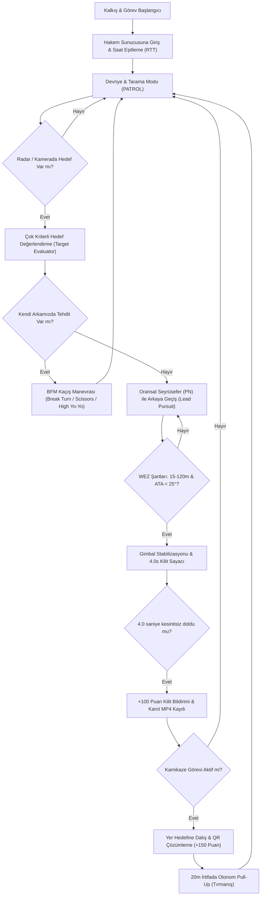

# 🦅 TEKNOFEST Savaşan İHA Rakip Analizi, Küresel Yarışmalar ve Kaynak Repolar Raporu

Bu doküman; TEKNOFEST Savaşan İHA kategorisinde yarışan şampiyon takımların teknik analizini, yarışma şartnamesindeki kritik puan tuzaklarını, küresel çaptaki askeri/akademik hava muharebe programlarını ve en iyi açık kaynak GitHub referans projelerini kapsamlı olarak inceler.

---

## 🏆 1. TEKNOFEST Savaşan İHA Yerel Rakip Analizi

Türkiye'de TEKNOFEST Savaşan İHA kategorisinde dereceye giren üniversite ve bağımsız takımların (İTÜ NOMAD/Albatros, Eflatun İHA, Selçuk İHA, Vefa İHA vb.) teknik profilleri ve sahadaki pratikleri incelendiğinde aşağıdaki mimari eğilimler öne çıkmaktadır:

### A. Donanım ve Sensör Mimarileri Karşılaştırması

| Bileşen | Standart Takım Yaklaşımı | Dereceye Giren Şampiyon Takımlar | **AeroCombat Yaklaşımı** |
| :--- | :--- | :--- | :--- |
| **Gövde Tipi** | Skywalker X8 veya Köpük Talon | Özel Karbon-Fiber Kompozit Sabit Kanat veya Hibrit VTOL | Optimize Sabit Kanat / Kanat Profili (Düşük Sürükleme) |
| **Görev Bilgisayarı** | Raspberry Pi 4 / 5 veya Jetson Nano | NVIDIA Jetson Orin Nano / AGX Orin | NVIDIA Jetson Orin Nano (TensorRT FP16 / INT8) |
| **Kamera Sensörü** | USB Web Kamerası (Rolling Shutter) | Sony IMX296 / IMX477 Global Shutter CSI-2 | Sony IMX296 Global Shutter + 2-Eksen Pan/Tilt Gimbal |
| **Otopilot** | Pixhawk 2.4.8 (Eski Klon) | Pixhawk 6C / Cube Orange+ (ArduPilot Plane) | Cube Orange+ / SITL Entegre PyMAVLink Köprüsü |
| **Telemetri Bağı** | 433 MHz Sik Modem veya 2.4 GHz WiFi | RFD900x (868/915 MHz) + Yedekli 4G LTE Dongle | RFD900x + CRC32 Tampon Kuyruğu (`packet_buffer.py`) |
| **Yer Anteni** | Standart omni dipol anten | Çift yönlü yama (patch) anten | Otomatik Yönlü Anten Takipçisi (`antenna_tracker.py`) |

---

### B. Rakiplerin En Çok Puan Kaybettiği 5 Kritik Nokta ve Çözümleri

TEKNOFEST Savaşan İHA finallerinde takımların elenmesine veya kilitlenme puanı alamamasına yol açan 5 ana teknik zafiyet şunlardır:

1. **%5 Alan Oranı Yanılgısı ve Kilit Reddi (-50 Ceza Puanı):**
   * *Zafiyet:* Rakipler hedefi kadrajda gördüğü an mesafeye bakmaksızın kilit sayacını başlatmakta; hedef %5'ten küçük kaldığı için hakem sunucusu paketi reddetmekte ve ardışık denemelerde takıma -50 ceza puanı verilmektedir.
   * *AeroCombat Çözümü:* `vision/lock_engine.py` ve `vision/optical_ranging.py` modülleri ile hem piksel alan oranı ($\ge 0.05$) hem de 3D optik menzil ($R \le 120\text{m}$) matematiksel olarak doğrulanmadan asla paket gönderilmez.

2. **Geofence Sınır İhlali ve Diskalifiye (-200 Puan):**
   * *Zafiyet:* İt dalaşı esnasında rakibi kovalayan avcı uçak, yüksek bank açılı dönüşlerde rüzgar sürüklenmesiyle (crosswind drift) yarışma sahasının dışına taşmakta ve diskalifiye olmaktadır.
   * *AeroCombat Çözümü:* `autopilot/geofence.py` ray-casting algoritması ile sınıra 25 metre kala ikaz üretir; ihlal anında otomatik RTL/Loiter tetikler. `autopilot/wind_estimator.py` ise Crab açısı düzeltmesi uygulayarak uçağı hatta tutar.

3. **Sunucu Saat Sapması ve HTTP 400 Bad Request:**
   * *Zafiyet:* Yer istasyonu saati hakem sunucusundan 1-2 saniye saptığında, kilit başlangıç ve bitiş zaman damgaları sunucu tarafından geçersiz sayılır.
   * *AeroCombat Çözümü:* `referee/time_sync.py` RTT gecikmesini ($\frac{t_{\text{cevap}} - t_{\text{istek}}}{2}$) hesaplayarak sunucu saatiyle milisaniyelik senkronize olur.

4. **Kameradan Hedef Kaçırma / Titreşim (Jello Effect):**
   * *Zafiyet:* Sabit kameralı uçaklarda keskin dönüş yapıldığında hedef anında kadraj dışına çıkmakta ve 4 saniyelik sayaç sıfırlanmaktadır.
   * *AeroCombat Çözümü:* 2-Eksen Fırçasız Gimbal (`vision/gimbal_controller.py`) kamerayı bağımsız olarak hedefe çevirerek sert dönüşlerde dahi hedefin kadraj merkezinde kalmasını sağlar; 0.35 saniyelik tolerans süresi (`kayip_toleransi_sn`) ise anlık kayıplarda sayacı sıfırlamaz.

5. **Havada Çarpışma (Mid-Air Collision) Riski:**
   * *Zafiyet:* 4-8 uçağın aynı hedefe yöneldiği ya da kafa kafaya (head-on) geldiği durumlarda çarpışma riski doğmaktadır.
   * *AeroCombat Çözümü:* `autopilot/collision_avoidance.py` (ACAS/TCAS), CPA ve $\tau_{\text{cpa}}$ hesaplayarak acil koordineli kaçınma (Resolution Advisory) uygular.

---

## 🌍 2. Küresel Çaptaki Eşdeğer ve Benzer Yarışmalar

TEKNOFEST Savaşan İHA kategorisinin küresel savunma sanayii ve akademideki karşılıkları:

### 1. DARPA ACE (Air Combat Evolution) & AlphaDogfight Trials (ABD)
* **Kategori:** Otonom Hava-Hava İt Dalaşı (WVR Dogfight)
* **Organizasyon:** DARPA (U.S. Defense Advanced Research Projects Agency) & U.S. Air Force
* **Analiz:** F-16 jeti simülasyonunda yapay zeka ajanlarının (Heron Systems) insan pilotları 5-0 yenmesiyle sonuçlanmıştır. Günümüzde otonom **X-62A VISTA** jetiyle gerçek uçuşlarda test edilmektedir.
* **AeroCombat Uyarlaması:** `autopilot/tactical_decision_agent.py` içindeki Antenna Train Angle (ATA), Aspect Angle (AA) ve WEZ (Weapon Engagement Zone) durum makinesi doğrudan DARPA ACE taktik doktrinlerinden esinlenmiştir.

### 2. MBZIRC (Mohamed Bin Zayed International Robotics Challenge - BAE)
* **Kategori:** Kaçak İHA Önleme ve Havada Yakalama (Rogue Drone Interception)
* **Organizasyon:** Khalifa University & ASPIRE (Abu Dhabi)
* **Analiz:** Dünyanın en yüksek bütçeli robotik yarışmalarından biridir. Yüksek hızla manevra yapan hedef drone'ları havada otonom tespit edip kovalama görevidir.
* **AeroCombat Uyarlaması:** Delayed Kalman Filter (DKF) gecikme kompanzasyonu (`latency_compensator.py`) ve Image-Based Visual Servoing (IBVS).

### 3. AUVSI SUAS (Student Unmanned Aerial Systems - ABD)
* **Kategori:** Otonom Seyrüsefer, Nesne Tespiti ve Hakem Sunucusu Haberleşmesi
* **Organizasyon:** RoboNation & AUVSI (Maryland, ABD)
* **Analiz:** TEKNOFEST'teki Merkezi Hakem Sistemi (MHS) REST API yapısının dünyadaki öncüsüdür (AUVSI Interoperability Server).
* **AeroCombat Uyarlaması:** JSON telemetri kuyruğu ve CRC32 paket tamponlama mekanizması (`referee/packet_buffer.py`).

### 4. IMAV (International Micro Air Vehicle Competition - Avrupa)
* **Kategori:** Mikro İHA Otonom Hava Muharebesi ve Balon Avlama
* **Organizasyon:** Avrupa MAV Konsorsiyumu (TU Delft, ISAE-Supaero)
* **Analiz:** İHA'ların havada hareketli hedeflere otonom kilitlenmesi ve balon patlatma yarışmasıdır.

### 5. DJI RoboMaster University AI Challenge (Çin / Global)
* **Kategori:** Otonom Zırh Tespiti, Gimbal Kilitlenme ve Sürekli Ateş
* **Analiz:** Yüksek FPS'li hedef tespiti ve milisaniye bazlı kilitlenme sayacı mantığı TEKNOFEST ile birebir örtüşür.

---

## 💻 3. İncelenen Açık Kaynak GitHub Repoları

### A. Yerel TEKNOFEST Savaşan İHA Repoları
1. **[`batikandemirci/savasan_iha`](https://github.com/batikandemirci/savasan_iha):**
   * *İnceleme:* YOLO11 tabanlı tespit, kilitlenme sayacı ve kamikaze dalış mantığı barındırır.
2. **[`koesan/Teknofest_Savasan_IHA`](https://github.com/koesan/Teknofest_Savasan_IHA):**
   * *İnceleme:* ArduPilot ve Gazebo entegrasyonu, temel takip modülleri.
3. **[`koustech/mastermind`](https://github.com/koustech/mastermind):**
   * *İnceleme:* Go dilinde geliştirilmiş mikroservis ve sonlu durum makinesi (FSM) yöneticisi.
4. **[`sezer-muhammed/Eflatun-IHA`](https://github.com/sezer-muhammed/Eflatun-IHA):**
   * *İnceleme:* ODTÜ Eflatun İHA takımının otonom seyrüsefer ve görüntü işleme yardımcı araçları.

### B. Küresel Hava Muharebesi ve Simülasyon Projeleri
5. **[`snu-larr/CloseAirCombat`](https://github.com/snu-larr/CloseAirCombat):**
   * *İnceleme:* Seul Ulusal Üniversitesi tarafından JSBSim 6-DOF FDM motoru ile geliştirilmiş 1v1 ve 2v2 hava muharebesi Gymnasium ortamı. Derin pekiştirmeli öğrenme (PPO/SAC) ile it dalaşı ajanları eğitir.
6. **[`JSBSim-Team/jsbsim`](https://github.com/JSBSim-Team/jsbsim):**
   * *İnceleme:* Havacılık ve savunma endüstrisinin 6 serbestlik dereceli en gelişmiş açık kaynak uçuş dinamiği modeli.
7. **[`mrwangyou/DBRL`](https://github.com/mrwangyou/DBRL):**
   * *İnceleme:* Deep Reinforcement Learning tabanlı BFM manevra kütüphanesi.
8. **[`Gor-Ren/gym-jsbsim`](https://github.com/Gor-Ren/gym-jsbsim):**
   * *İnceleme:* OpenAI Gym ve JSBSim köprüsüyle otonom uçuş kontrolü eğitimi.

### C. Görsel Güdüm, C-UAS ve Hedef Takibi
9. **[`NadavCherry/SpeckLock`](https://github.com/NadavCherry/SpeckLock):**
   * *İnceleme:* NVIDIA Isaac Sim üzerinde test edilmiş, hareketli kameradan minik İHA'ları (3-15 piksel) dahi tespit edip Proportional Navigation (PN) ile kovalayan algoritma.
10. **[`doguilmak/Drone-Detection-YOLOv11x`](https://github.com/doguilmak/Drone-Detection-YOLOv11x):**
    * *İnceleme:* Gökyüzündeki İHA'ları tespit etmek için özel eğitilmiş yüksek hassasiyetli YOLOv11 mimarisi.
11. **[`Lexicon121/Strix-Interceptor`](https://github.com/Lexicon121/Strix-Interceptor):**
    * *İnceleme:* Pixhawk otopilotu ile hava hedeflerini otonom olarak yakalayıp etkisiz hale getiren C-UAS (Counter-UAS) avcı İHA yazılımı.
12. **[`Zhefan-Xu/Autonomous-Flight-ROS2`](https://github.com/Zhefan-Xu/Autonomous-Flight-ROS2):**
    * *İnceleme:* İHA'lar için gerçek zamanlı yörünge üretimi (trajectory generation) ve engel kaçınma.

---

## 🎯 4. AeroCombat Şampiyonluk Stratejisi (Tactical Playbook)

AeroCombat mimarisinin sahada şampiyonluğu hedefleyen operasyonel taktikleri:

### Stratejik Puan Kaldıraçları:
1. **Kamikaze Görevi (+150 Puan):** 1.5 hava kilidine eşdeğerdir. Yer hedefi koordinatı alınır alınmaz önceliklendirilmeli ve $20\text{m}$ pull-up emniyetiyle tamamlanmalıdır.
2. **Kademeli Failsafe ile Kırımsız Uçuş:** Batarya veya bağlantı krizlerinde uçağı riske atmadan otonom RTL moduna geçerek uçuş emniyetini garantilemek.
3. **Sürü İle İki Ateş Arasına Alma (Pincer):** İki uçaklı görevlerde hedefin bir uçaktan kaçarken diğerinin kilitlenme konisine girmesini sağlamak.
